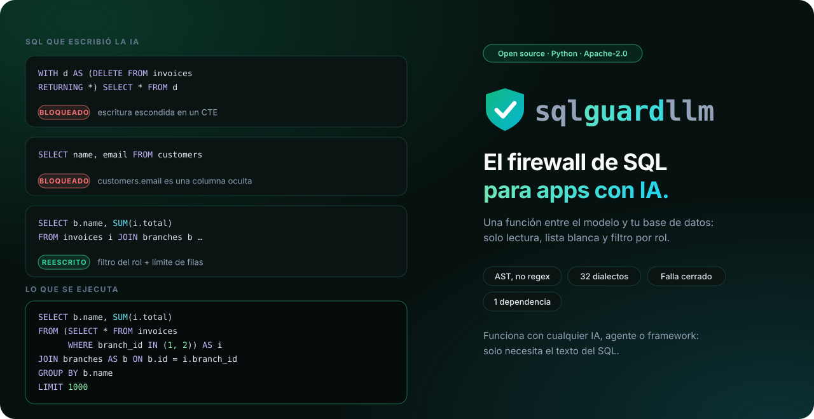
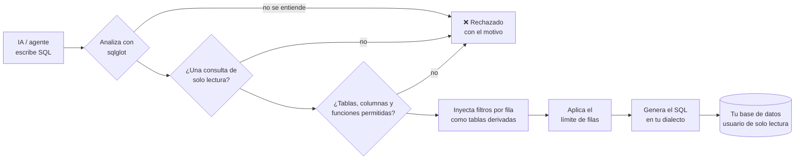

<div align="center">

[](README.md)
[](README.es.md)

<picture>
  <source media="(prefers-color-scheme: dark)" srcset="docs/assets/logo-dark.svg">
  
</picture>

### El firewall de SQL para apps con IA.

Tu modelo escribe SQL. **sqlguardllm** se asegura de que solo pueda leer lo permitido: una única consulta de solo lectura, tablas y columnas en lista blanca, filtros por fila según el usuario y un límite de filas, en cualquiera de los 32 dialectos que entiende [sqlglot](https://github.com/tobymao/sqlglot).

[](https://pypi.org/project/sqlguardllm/)
[](https://github.com/jmmana/sqlguardllm/actions/workflows/ci.yml)
[](LICENSE)
[](docs/DESIGN.md)
[](https://github.com/tobymao/sqlglot)
[](CONTRIBUTING.md)



</div>

> [!NOTE]
> **Estado: alfa.** La versión `0.2.0a2` está en [PyPI](https://pypi.org/project/sqlguardllm/) (`pip install sqlguardllm`, `import sqlguardllm`), con las reglas de [docs/DESIGN.md](docs/DESIGN.md), límites opcionales de complejidad y un corpus adversarial de 102 casos. La API puede cambiar antes de la 1.0; los códigos de violación son estables. Dale ⭐ para seguir el avance y opina en [Discussions](https://github.com/jmmana/sqlguardllm/discussions).
>
> La documentación técnica está en inglés para llegar a más desarrolladores. Los issues y PR en español son bienvenidos.

---

## Por qué

Las apps con IA que hablan con bases de datos (text-to-SQL, agentes de datos, herramientas MCP) comparten el mismo riesgo: **el modelo escribe SQL, y tarde o temprano alguien logrará que escriba el SQL equivocado.** Con una inyección de prompt, una fila maliciosa en tus propios datos o una simple alucinación.

La defensa habitual es una lista de palabras prohibidas, y falla **en las dos direcciones**:

| SQL | Filtro de palabras (`"DELETE" in sql`) | Lo que realmente es |
|---|---|---|
| `SELECT 'x; DROP TABLE invoices' AS note` | ❌ La bloquea | Una lectura inofensiva con un texto |
| `WITH d AS (DELETE FROM invoices RETURNING *) SELECT * FROM d` | ✅ La bloquea, de suerte | Una escritura escondida en un CTE. Con un comentario o mayúsculas raras el filtro no la ve |
| `SELECT * INTO backup FROM invoices` | ⚠️ La deja pasar: empieza con `SELECT` | Crea una tabla nueva (SQL Server) |
| `SELECT name, email FROM customers` | ⚠️ La deja pasar | Lee datos personales que el modelo nunca debería ver |

sqlguardllm convierte la sentencia en un árbol sintáctico con sqlglot y **decide sobre el árbol, no sobre el texto**. Después reescribe la consulta para que solo vea las filas que el usuario actual puede ver.

## Qué garantiza

| | Regla |
|---|---|
| 1️⃣ | **Una sola sentencia**, y que sea una consulta (`SELECT`, `UNION`, `WITH … SELECT`). Nada encadenado tras un `;` |
| 2️⃣ | **Solo lectura en todo el árbol**: ni `INSERT`, `UPDATE`, `DELETE`, `MERGE`, `SELECT … INTO`, DDL, `COPY`, `ATTACH`, `PRAGMA`, `EXEC` ni bloqueos de filas, a ninguna profundidad |
| 3️⃣ | **Tablas en lista blanca y columnas ocultas**: entiende los CTE; `SELECT *` sobre una tabla con columnas ocultas se rechaza |
| 4️⃣ | **Funciones prohibidas** por dialecto: lectura de archivos, esperas, shell, red (`pg_read_file`, `pg_sleep`, `LOAD_FILE`, `OPENROWSET`, `DBMS_PIPE.*`…) |
| 5️⃣ | **Filtros por fila**: cada aparición de una tabla se vuelve una tabla derivada filtrada, con los valores del usuario como literales escapados |
| 6️⃣ | **Límite de filas** aplicado o reducido, con la sintaxis de cada dialecto (`LIMIT`, `TOP`, `FETCH FIRST`) |
| 🔒 | **Falla cerrado**: si el SQL no se puede analizar, o al contexto le falta un valor que exige un filtro, la respuesta es *no* |

### Límites opcionales

Apagados por defecto; activa los que necesites. Frenan consultas mucho más costosas que la pregunta que las originó.

| Opción de la política | Qué hace | Violación |
|---|---|---|
| `max_joins=4` | Limita los joins de toda la consulta, contando CTE y subconsultas | `too_complex` |
| `max_subquery_depth=2` | Limita el anidamiento de subconsultas, tablas derivadas y CTE | `too_complex` |
| `forbid_cartesian=True` | Rechaza `CROSS JOIN` y joins con coma sin una igualdad que los una en el `WHERE` | `too_complex` |
| `required_filters={"invoices": ["issued_at"]}` | Toda lectura de la tabla debe filtrar por una de esas columnas, como un rango de fechas en una tabla de hechos grande | `missing_required_filter` |
| `output_dialect="tsql"` | El modelo escribe PostgreSQL y el SQL reescrito sale para SQL Server, Oracle o cualquier dialecto de sqlglot | — |
| `masked_columns={"customers.email": "partial"}` | La columna se puede seleccionar pero vuelve enmascarada: `null`, `redact` (`***`), `hash` (SHA-256) o `partial` (`ju***`). Filtrar, unir, agrupar u ordenar por ella se rechaza | `hidden_column` |
| `aggregate_only={"salaries": 5}` | La tabla solo se puede leer con agregados, y los grupos de menos de 5 filas nunca vuelven (`HAVING COUNT(*) >= 5`) | `aggregate_required` |

## Un vistazo

```bash
pip install sqlguardllm          # Python 3.10+, una sola dependencia: sqlglot
```

```python
from sqlguardllm import Guard, Policy

guard = Guard(Policy(
    dialect="postgres",
    tables={"invoices", "branches", "customers"},
    hidden_columns={"customers.email", "customers.tax_id"},
    row_filters={"invoices": "branch_id IN ({user.branches})"},
    max_rows=1000,
))

result = guard.check(sql_de_la_ia, context={"user": {"branches": [1, 2]}})

if result.ok:
    filas = db.execute(result.sql)     # solo lectura, filtrado por rol y con límite
else:
    for v in result.violations:
        print(v.code, v.message)       # write_operation: DELETE dentro de un CTE…
```

No le importa qué modelo, framework de agentes u ORM produjo el SQL: **solo necesita el texto del SQL.**

## Cómo funciona



Lo que se ejecuta es el SQL regenerado desde el árbol validado, nunca el texto original.

## Seguridad por fila, reescrita

Cada aparición de una tabla filtrada se reemplaza por una tabla derivada que conserva su alias, así el filtro se mantiene en joins, subconsultas y CTE. Salida real de sqlglot para un usuario que solo ve las sucursales 1 y 2:

<table>
<tr><th>Lo que escribió la IA</th><th>Lo que se ejecuta</th></tr>
<tr>
<td>

```sql
SELECT b.name, SUM(i.total)
FROM invoices i
JOIN branches b ON b.id = i.branch_id
GROUP BY b.name
```

</td>
<td>

```sql
SELECT b.name, SUM(i.total)
FROM (
  SELECT * FROM invoices
  WHERE branch_id IN (1, 2)
) AS i
JOIN branches AS b ON b.id = i.branch_id
GROUP BY b.name
LIMIT 1000
```

</td>
</tr>
</table>

Igual en SQL Server, donde el límite es `TOP 500`, o en Oracle, donde es `FETCH FIRST 100 ROWS ONLY`. Más ejemplos en [docs/DESIGN.md](docs/DESIGN.md#7-row-filters).

## Galería de ataques

Lo que sqlglot 30.35 realmente ve en cada intento y qué hace sqlguardllm. Cada fila es un caso de prueba; la lista completa está en [docs/ATTACK_GALLERY.md](docs/ATTACK_GALLERY.md).

| Dialecto | Intento | sqlglot ve | sqlguardllm |
|---|---|---|---|
| postgres | `WITH d AS (DELETE FROM invoices RETURNING *) SELECT * FROM d` | raíz `Select` con un `Delete` dentro | ❌ `write_operation` |
| tsql | `SELECT 1; DROP TABLE invoices` | 2 sentencias | ❌ `multiple_statements` |
| tsql | `SELECT * INTO backup FROM invoices` | `Select` con un nodo `Into` | ❌ `write_operation` |
| postgres | `SELECT * FROM invoices FOR UPDATE` | `Select` con un `Lock` | ❌ `row_lock` |
| mysql | `SELECT * FROM invoices INTO OUTFILE '/tmp/x'` | error de análisis | ❌ `parse_error` (falla cerrado) |
| sqlite | `ATTACH DATABASE '/tmp/x.db' AS x` | `Attach` | ❌ `not_a_query` |
| postgres | `SELECT pg_read_file('/etc/passwd')` | función `pg_read_file` | ❌ `denied_function` |
| oracle | `SELECT DBMS_PIPE.RECEIVE_MESSAGE('a', 10) FROM dual` | llamada calificada | ❌ `denied_function` |
| postgres | `SELECT 'x; DROP TABLE invoices' AS note` | un `Select` con un texto | ✅ permitido |
| postgres | `SELECT 1 /* ; DROP TABLE invoices */` | un `Select` con un comentario | ✅ permitido |

¿Encontraste cómo saltártelo? Es una vulnerabilidad: [repórtala en privado](SECURITY.md).

## Dónde encaja

sqlguardllm es **una capa**, no la única. Mantén las demás:

1. **Un usuario de base de datos de solo lectura** con acceso solo a las tablas que la app necesita. No es negociable.
2. **sqlguardllm** entre el modelo y la base: forma, listas blancas, filtros por fila y límites.
3. **Tiempos máximos** en la base, contra consultas costosas.
4. **Auditoría** de cada SQL ejecutado y para quién.

Lo que no hace, y por qué, está en el [modelo de amenazas](docs/THREAT_MODEL.md).

## Con tu stack

sqlguardllm va donde tu app ejecuta el SQL que escribió el modelo. Las recetas planeadas para la v0.3 cubrirán un envoltorio genérico de `execute()`, las herramientas SQL de LangChain y LlamaIndex, Vanna y servidores MCP de bases de datos. Ver [docs/INTEGRATIONS.md](docs/INTEGRATIONS.md).

La herramienta de línea de comandos sirve en CI y para probar políticas. Sale con 0 si la consulta se permite (e imprime el SQL reescrito), 1 si se rechaza (e imprime las violaciones) y 2 ante un error de uso o de la política:

```bash
sqlguardllm check --policy policy.yaml --context '{"user": {"branches": [1, 2]}}' \
  "SELECT * FROM invoices"
echo "SELECT …" | sqlguardllm check --policy policy.yaml --format json --language es -
```

Los archivos de política tienen un [JSON Schema](schema/policy.schema.json) para autocompletar en VS Code y otros editores.

## Otros lenguajes

Hoy sqlguardllm es una librería de Python: su motor es [sqlglot](https://github.com/tobymao/sqlglot), que solo existe en Python, y tres motores en tres lenguajes podrían comportarse distinto, que en una librería de seguridad es lo mismo que un hueco. **Node.js y .NET están planeados** como un motor con varios clientes: `sqlguardllm serve` (un servicio HTTP al lado de tu app, con imagen Docker) y clientes oficiales para npm y NuGet, con el corpus de ataques como prueba de conformidad para que todos los lenguajes se comporten igual. Síguelo en [Later · Node.js and .NET](https://github.com/jmmana/sqlguardllm/milestone/6) y en el [diseño](docs/DESIGN.md#other-languages). Mientras tanto, cualquier lenguaje puede usar el servidor MCP (v0.4) o la CLI (v0.2).

## Playground: intenta romperlo

Un playground estático (planeado para la v0.3) correrá sqlguardllm **entero en tu navegador** con Pyodide y una base SQLite de demostración: elige un rol, escribe el SQL más malicioso que se te ocurra y mira cómo se bloquea o se reescribe. Sin servidor y sin registro.

## Roadmap

| Hito | Alcance |
|---|---|
| [**v0.1 · Core guard**](https://github.com/jmmana/sqlguardllm/milestone/1) | Validación de sentencia y solo lectura, listas blancas, columnas ocultas, funciones prohibidas, límite de filas, corpus adversarial |
| [**v0.2 · Row-level security & CLI**](https://github.com/jmmana/sqlguardllm/milestone/2) | Filtros por fila como tablas derivadas, archivos de política, CLI, matriz de dialectos, sitio de documentación, publicación en PyPI |
| [**v0.3 · More power**](https://github.com/jmmana/sqlguardllm/milestone/4) | Límites de complejidad, filtros obligatorios, enmascarado de datos personales, tablas de solo agregados (k-anonimato), esquema exacto leído de la base, políticas por rol, `explain()`, traducción de dialecto |
| [**v0.4 · MCP server**](https://github.com/jmmana/sqlguardllm/milestone/5) | Una herramienta de base de datos segura para Claude Desktop, Cursor y cualquier agente, con control de costo opcional |
| [**v0.5 · Ecosystem & playground**](https://github.com/jmmana/sqlguardllm/milestone/3) | Recetas de integración, playground en el navegador, presupuesto de rendimiento |
| [**Later · Node.js and .NET**](https://github.com/jmmana/sqlguardllm/milestone/6) | Un motor, varios clientes: modo servidor y clientes para npm y NuGet |

Detalle en [docs/ROADMAP.md](docs/ROADMAP.md).

## Contribuir

Las contribuciones son muy bienvenidas, y algunas de las más valiosas no requieren conocer el código a fondo:

- **Agregar casos de ataque** al corpus adversarial, sobre todo en los dialectos que conoces bien.
- **Ampliar las listas de funciones prohibidas** de tu motor de base de datos.
- **Traducir los mensajes** de las violaciones.
- **Cuestionar el diseño** en [Discussions](https://github.com/jmmana/sqlguardllm/discussions) antes de que la v0.1 congele la API.

Empieza por [CONTRIBUTING.md](CONTRIBUTING.md) y los [good first issues](https://github.com/jmmana/sqlguardllm/labels/good%20first%20issue). El proyecto sigue un [Código de conducta](CODE_OF_CONDUCT.md).

## Seguridad

Saltarse sqlguardllm es una vulnerabilidad de seguridad. **No abras un issue público:** repórtala en privado como explica [SECURITY.md](SECURITY.md).

## Licencia

[Apache-2.0](LICENSE) © 2026 Juan Castillo. sqlguardllm nació dentro de [ChatIApp](https://github.com/jmmana/ChatIApp), un chat open source que convierte preguntas de negocio en SQL seguro.
