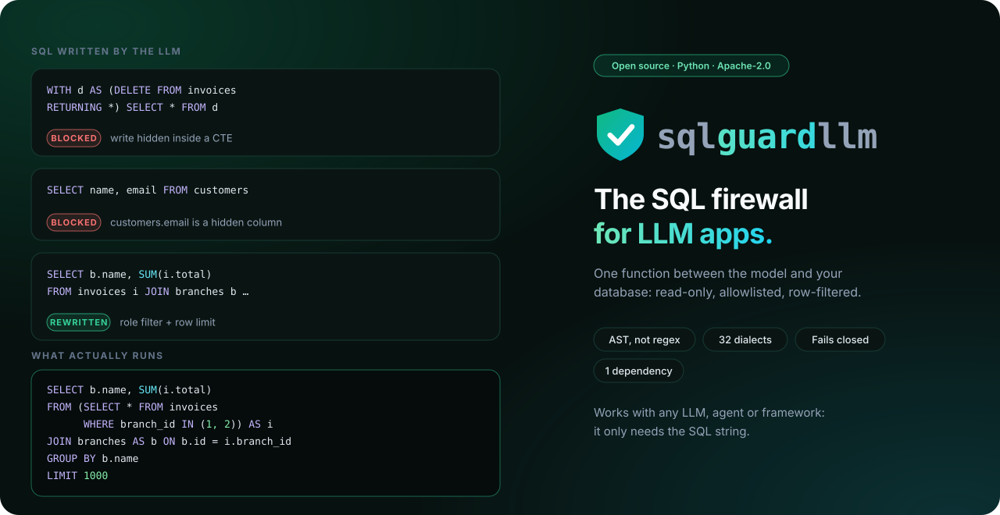
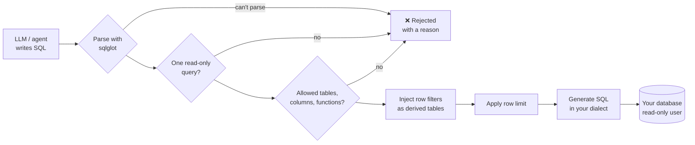

<div align="center">

[](README.md)
[](README.es.md)

<picture>
  <source media="(prefers-color-scheme: dark)" srcset="docs/assets/logo-dark.svg">
  
</picture>

### The SQL firewall for LLM apps.

Your model writes SQL. **sqlguardllm** makes sure it can only read what it's allowed to read: one read-only statement, allowlisted tables and columns, row-level filters per user, and a row limit, in any of the 32 dialects [sqlglot](https://github.com/tobymao/sqlglot) speaks.

[](https://pypi.org/project/sqlguardllm/)
[](https://github.com/jmmana/sqlguardllm/actions/workflows/ci.yml)
[](LICENSE)
[](docs/DESIGN.md)
[](https://github.com/tobymao/sqlglot)
[](CONTRIBUTING.md)



</div>

> [!NOTE]
> **Status: alpha.** `0.4.0a1` is on [PyPI](https://pypi.org/project/sqlguardllm/) (`pip install sqlguardllm`, `import sqlguardllm`), with the rules of [docs/DESIGN.md](docs/DESIGN.md), optional complexity limits and a 107-case adversarial corpus. The API may still change before 1.0; violation codes are stable. ⭐ Star the repo to follow along, and tell us what you think in [Discussions](https://github.com/jmmana/sqlguardllm/discussions).

---

## Why

LLM apps that talk to databases (text-to-SQL, data agents, MCP database tools) all share the same risk: **the model writes SQL, and someone will eventually make it write the wrong SQL.** Through a prompt injection, a malicious row in your own data, or a plain hallucination.

The usual defense is a keyword blocklist. It fails in **both** directions:

| SQL | Keyword filter (`"DELETE" in sql`) | What it actually is |
|---|---|---|
| `SELECT 'x; DROP TABLE invoices' AS note` | ❌ Blocks it | A harmless read with a string literal |
| `WITH d AS (DELETE FROM invoices RETURNING *) SELECT * FROM d` | ✅ Blocks it, by luck | A write hidden inside a CTE. Spell it with a comment or odd casing and the filter misses it |
| `SELECT * INTO backup FROM invoices` | ⚠️ Lets it through: it starts with `SELECT` | Creates a new table (SQL Server) |
| `SELECT name, email FROM customers` | ⚠️ Lets it through | Reads personal data the model should never see |

sqlguardllm parses the statement into a syntax tree with sqlglot and **decides on the tree, not on the text**. Then it rewrites the query so it can only see the rows the current user is allowed to see.

## What it guarantees

| | Rule |
|---|---|
| 1️⃣ | **One statement** that is a query (`SELECT`, `UNION`, `WITH … SELECT`). Nothing stacked after a `;` |
| 2️⃣ | **Read-only across the whole tree**: no `INSERT`, `UPDATE`, `DELETE`, `MERGE`, `SELECT … INTO`, DDL, `COPY`, `ATTACH`, `PRAGMA`, `EXEC`, row locks… at any depth |
| 3️⃣ | **Allowlisted tables and hidden columns**: CTE-aware; `SELECT *` on a table with hidden columns is rejected |
| 4️⃣ | **Denied functions** per dialect: file readers, sleeps, shells, network calls (`pg_read_file`, `pg_sleep`, `LOAD_FILE`, `OPENROWSET`, `DBMS_PIPE.*`…) |
| 5️⃣ | **Row-level filters**: every occurrence of a table becomes a filtered derived table, with the user's values bound as escaped literals |
| 6️⃣ | **Row limit** applied or lowered, in the dialect's own syntax (`LIMIT`, `TOP`, `FETCH FIRST`) |
| 🔒 | **Fails closed**: if the SQL can't be parsed, or the user context is missing a value a filter needs, the answer is *no* |

### Optional limits

Off by default; turn on what you need. They stop queries that are far more expensive than the question that produced them.

| Policy option | What it does | Violation |
|---|---|---|
| `max_joins=4` | Caps joins in the whole query, CTEs and subqueries included | `too_complex` |
| `max_subquery_depth=2` | Caps nesting of subqueries, derived tables and CTEs | `too_complex` |
| `forbid_cartesian=True` | Rejects `CROSS JOIN` and comma joins with no linking equality in `WHERE` | `too_complex` |
| `required_filters={"invoices": ["issued_at"]}` | Every read of the table must filter on one of the columns, such as a date range on a big fact table | `missing_required_filter` |
| `output_dialect="tsql"` | The model writes PostgreSQL; the rewritten SQL comes out for SQL Server, Oracle or any sqlglot dialect | — |
| `masked_columns={"customers.email": "partial"}` | The column can be selected but comes back masked: `null`, `redact` (`***`), `hash` (SHA-256) or `partial` (`ju***`). Filtering, joining, grouping or sorting by it is rejected | `hidden_column` |
| `aggregate_only={"salaries": 5}` | The table can only be read through aggregates, and groups smaller than 5 rows never come back (`HAVING COUNT(*) >= 5`) | `aggregate_required` |

## Quick look

```bash
pip install sqlguardllm          # Python 3.10+, one dependency: sqlglot
```

```python
from sqlguardllm import Guard, Policy

guard = Guard(Policy(
    dialect="postgres",
    tables={"invoices", "branches", "customers"},
    hidden_columns={"customers.email", "customers.tax_id"},
    row_filters={"invoices": "branch_id IN ({user.branches})"},
    max_rows=1000,
))

result = guard.check(sql_from_llm, context={"user": {"branches": [1, 2]}})

if result.ok:
    rows = db.execute(result.sql)      # read-only, row-filtered, limited
else:
    for v in result.violations:
        print(v.code, v.message)       # write_operation: DELETE inside a CTE…
```

It doesn't care which model, agent framework or ORM produced the SQL: **it only needs the SQL string.**

## How it works



What runs is the SQL regenerated from the validated tree, never the original string.

## Row-level security, rewritten

Each occurrence of a filtered table is replaced by a derived table that keeps its alias, so the filter holds inside joins, subqueries and CTEs. Real sqlglot output for a user who can only see branches 1 and 2:

<table>
<tr><th>The LLM wrote</th><th>What runs</th></tr>
<tr>
<td>

```sql
SELECT b.name, SUM(i.total)
FROM invoices i
JOIN branches b ON b.id = i.branch_id
GROUP BY b.name
```

</td>
<td>

```sql
SELECT b.name, SUM(i.total)
FROM (
  SELECT * FROM invoices
  WHERE branch_id IN (1, 2)
) AS i
JOIN branches AS b ON b.id = i.branch_id
GROUP BY b.name
LIMIT 1000
```

</td>
</tr>
</table>

Same idea on SQL Server, where the limit becomes `TOP 500`, or Oracle, where it becomes `FETCH FIRST 100 ROWS ONLY`. More examples in [docs/DESIGN.md](docs/DESIGN.md#7-row-filters).

## Attack gallery

What sqlglot 30.35 actually sees for each attempt, and what sqlguardllm does about it. Every row is a test case. The full list is in [docs/ATTACK_GALLERY.md](docs/ATTACK_GALLERY.md).

| Dialect | Attempt | sqlglot sees | sqlguardllm |
|---|---|---|---|
| postgres | `WITH d AS (DELETE FROM invoices RETURNING *) SELECT * FROM d` | `Select` root with a `Delete` inside | ❌ `write_operation` |
| tsql | `SELECT 1; DROP TABLE invoices` | 2 statements | ❌ `multiple_statements` |
| tsql | `SELECT * INTO backup FROM invoices` | `Select` with an `Into` node | ❌ `write_operation` |
| postgres | `SELECT * FROM invoices FOR UPDATE` | `Select` with a `Lock` | ❌ `row_lock` |
| mysql | `SELECT * FROM invoices INTO OUTFILE '/tmp/x'` | parse error | ❌ `parse_error` (fails closed) |
| sqlite | `ATTACH DATABASE '/tmp/x.db' AS x` | `Attach` | ❌ `not_a_query` |
| postgres | `SELECT pg_read_file('/etc/passwd')` | function `pg_read_file` | ❌ `denied_function` |
| oracle | `SELECT DBMS_PIPE.RECEIVE_MESSAGE('a', 10) FROM dual` | qualified function call | ❌ `denied_function` |
| postgres | `SELECT 'x; DROP TABLE invoices' AS note` | one `Select`, a string literal | ✅ allowed |
| postgres | `SELECT 1 /* ; DROP TABLE invoices */` | one `Select`, a comment | ✅ allowed |

Found a way through? That's a vulnerability: please [report it privately](SECURITY.md).

## Where it fits

sqlguardllm is **one layer**, not the only one. Keep the others:

1. **A read-only database user** with access to only the tables the app needs. Non-negotiable.
2. **sqlguardllm** between the model and the database: shape, allowlists, row filters, limits.
3. **Statement timeouts** in the database, against expensive queries.
4. **Audit logs** of every SQL that ran and for whom.

What it does not do, and why, is in the [threat model](docs/THREAT_MODEL.md).

## Works with your stack

sqlguardllm sits wherever your app executes the SQL the model wrote. Recipes, planned for v0.3, will cover a generic `execute()` wrapper, LangChain and LlamaIndex SQL tools, Vanna, and MCP database servers. See [docs/INTEGRATIONS.md](docs/INTEGRATIONS.md).

The command-line tool is handy in CI and for trying policies. Exit code 0 means allowed (it prints the rewritten SQL), 1 rejected (it prints the violations) and 2 a usage or policy error:

```bash
sqlguardllm check --policy policy.yaml --context '{"user": {"branches": [1, 2]}}' \
  "SELECT * FROM invoices"
echo "SELECT …" | sqlguardllm check --policy policy.yaml --format json -
```

Policy files have a [JSON Schema](schema/policy.schema.json) for autocompletion in VS Code and other editors.

**MCP server:** `sqlguardllm mcp` gives Claude Desktop, Cursor and VS Code a database tool that can't write, see hidden data or escape row filters; copy-paste setup in [docs/MCP.md](docs/MCP.md).

## Other languages

sqlguardllm is a Python library today: its engine is [sqlglot](https://github.com/tobymao/sqlglot), which only exists in Python, and three engines in three languages could disagree, which in a security library means a bypass. **Node.js and .NET are planned** as one engine with many clients: `sqlguardllm serve` (an HTTP sidecar and Docker image) plus official npm and NuGet clients, with the attack corpus as a conformance suite so every language behaves the same. Follow it in [Later · Node.js and .NET](https://github.com/jmmana/sqlguardllm/milestone/6) and the [design](docs/DESIGN.md#other-languages). Until then, any language can use the MCP server (v0.4) or the CLI (v0.2).

## Playground: try to break it

A static playground (planned for v0.3) will run sqlguardllm **entirely in your browser** with Pyodide and a demo SQLite database: pick a role, type the nastiest SQL you can think of, and watch it get blocked or rewritten. No server, no sign-up.

## Roadmap

| Milestone | Scope |
|---|---|
| [**v0.1 · Core guard**](https://github.com/jmmana/sqlguardllm/milestone/1) | Statement and read-only checks, allowlists, hidden columns, denied functions, row limit, adversarial corpus |
| [**v0.2 · Row-level security & CLI**](https://github.com/jmmana/sqlguardllm/milestone/2) | Row filters as derived tables, policy files, CLI, dialect test matrix, docs site, PyPI release |
| [**v0.3 · More power**](https://github.com/jmmana/sqlguardllm/milestone/4) | Complexity limits, required filters, PII masking, aggregate-only tables (k-anonymity), exact schema from the database, policies per role, `explain()`, dialect translation |
| [**v0.4 · MCP server**](https://github.com/jmmana/sqlguardllm/milestone/5) | A safe database tool for Claude Desktop, Cursor and any agent, with an optional cost guard |
| [**v0.5 · Ecosystem & playground**](https://github.com/jmmana/sqlguardllm/milestone/3) | Integration recipes, browser playground, performance budget |
| [**Later · Node.js and .NET**](https://github.com/jmmana/sqlguardllm/milestone/6) | One engine, many clients: server mode plus npm and NuGet clients |

Details in [docs/ROADMAP.md](docs/ROADMAP.md).

## Contributing

Contributions are very welcome, and some of the most valuable ones need no deep knowledge of the codebase:

- **Add attack cases** to the adversarial corpus, especially for dialects you know well.
- **Extend the denied-function lists** for your database.
- **Translate violation messages.**
- **Challenge the design** in [Discussions](https://github.com/jmmana/sqlguardllm/discussions) before v0.1 freezes the API.

Start with [CONTRIBUTING.md](CONTRIBUTING.md) and the [good first issues](https://github.com/jmmana/sqlguardllm/labels/good%20first%20issue). This project follows a [Code of Conduct](CODE_OF_CONDUCT.md).

## Security

A bypass of sqlguardllm is a security vulnerability. **Don't open a public issue:** report it privately as described in [SECURITY.md](SECURITY.md).

## License

[Apache-2.0](LICENSE) © 2026 Juan Castillo. sqlguardllm was born inside [ChatIApp](https://github.com/jmmana/ChatIApp), an open-source chat that turns business questions into safe SQL.
