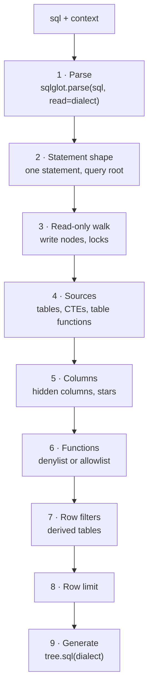

# Design

> Status: **implemented in 0.1.0a1**, except `Policy(schema=...)` for exact column checks (step 5) and the CLI (v0.2). This document is the contract the implementation and its tests follow; changes to it go through a pull request and, if they change behavior, a note in the changelog.

## Goals

1. Decide whether a SQL string written by an untrusted source (an LLM, an agent, a user) is a **single read-only query over allowed objects**.
2. **Rewrite** it so it can only see the rows the current user may see, and only up to a row limit.
3. Do it **deterministically, offline and fast**: no network, no LLM, one dependency ([sqlglot](https://github.com/tobymao/sqlglot)).
4. **Fail closed**: anything that can't be understood is rejected with a reason.

## Non-goals

- Replacing database permissions. A read-only database user is still required (see [THREAT_MODEL.md](THREAT_MODEL.md)).
- Judging whether the SQL answers the user's question correctly.
- Estimating query cost. Use the database's statement timeout; cost heuristics may come later.
- Detecting prompt injection in natural language. sqlguardllm makes a successful injection harmless for data access; it doesn't try to spot it.

## Public API (v0.1)

```python
from sqlguardllm import Guard, Policy, GuardViolation

policy = Policy(
    dialect="postgres",                       # any sqlglot dialect name
    tables={"invoices", "branches", "sales.customers"},
    hidden_columns={"customers.email"},       # "table.column"
    row_filters={"invoices": "branch_id IN ({user.branches})"},
    max_rows=1000,
    default_schema=None,                      # schema assumed for unqualified references
    denied_functions=None,                    # None = built-in list for the dialect
    extra_denied_functions=set(),             # added to the built-in list
    function_policy="denylist",               # "denylist" (default) or "allowlist"
    allowed_functions=None,                   # required when function_policy="allowlist"
    # Optional limits (0.2), all off by default:
    max_joins=None,                           # joins in the whole query
    max_subquery_depth=None,                  # nesting of subqueries, derived tables and CTEs
    forbid_cartesian=False,                   # CROSS JOIN and unlinked comma joins
    required_filters={},                      # {"invoices": ["issued_at"]}
    output_dialect=None,                      # generate in another dialect
)

guard = Guard(policy)                         # validates the policy once (fails fast)

result = guard.check(sql, context={"user": {"branches": [1, 2]}})
result.ok                # bool
result.sql               # rewritten SQL in policy.dialect, or None
result.tables            # frozenset of tables the query reads (after resolution)
result.applied_filters   # list[str], one per injected row filter
result.violations        # list[Violation(code, message, snippet)]

safe_sql = guard.enforce(sql, context=...)    # returns result.sql or raises GuardViolation
safe_execute = guard.wrap(execute, context_fn=lambda: {...})   # decorator-style helper
```

`Policy` is an immutable dataclass. It can also be loaded from YAML or JSON (`Policy.from_file("policy.yaml")`, v0.2).

### Violation codes

Codes are part of the public API and **stable across minor versions**. Messages are human-readable, available in English and Spanish, and may change.

| Code | Meaning |
|---|---|
| `parse_error` | sqlglot could not parse the SQL in the policy's dialect, or fell back to a raw `Command` |
| `empty_statement` | Nothing to run |
| `multiple_statements` | More than one statement |
| `not_a_query` | The statement is not a `SELECT`-family query (`ATTACH`, `PRAGMA`, `EXEC`, `SET`, `CALL`…) |
| `write_operation` | A write or DDL node appears anywhere in the tree (`Insert`, `Update`, `Delete`, `Merge`, `Into`, `Create`, `Drop`, `Alter`, `TruncateTable`, `Copy`…) |
| `row_lock` | `FOR UPDATE` / `FOR SHARE` and similar locking clauses |
| `table_not_allowed` | A table outside the allowlist, including table-valued functions that read external data |
| `hidden_column` | A hidden column is referenced anywhere (select list, `WHERE`, `JOIN`, `ORDER BY`…) or reachable through `*` |
| `denied_function` | A denied function, or any non-allowlisted function in allowlist mode |
| `missing_context` | A row filter needs a context value that wasn't provided |
| `invalid_context` | A context value has a type that can't be bound safely as a literal |
| `too_complex` | The query exceeds `max_joins`, `max_subquery_depth` or `forbid_cartesian` |
| `missing_required_filter` | A table in `required_filters` is read without a predicate on one of its columns |
| `aggregate_required` | A table in `aggregate_only` is read without aggregating (raw columns, `*`, or window functions) |

## Pipeline



Steps 1–6 collect **all** violations rather than stopping at the first, so callers (and LLM repair loops) get the full picture. Steps 7–9 only run when there are none.

### 1. Parse

- `sqlglot.parse(sql, read=policy.dialect)` with errors raised, not warned.
- Any `ParseError` → `parse_error`. Verified with sqlglot 30.35: MySQL `SELECT … INTO OUTFILE` and T-SQL `WAITFOR DELAY` don't parse, so they are rejected here.
- When sqlglot falls back to a raw `exp.Command` (it logs *"contains unsupported syntax. Falling back to parsing as a 'Command'"*, e.g. `LOCK TABLE`, `SET ROLE`, `CALL`), the result is `not_a_query`: we never pass through text we didn't parse.

### 2. Statement shape

- Exactly one non-empty statement, else `empty_statement` / `multiple_statements`.
- The root must be `exp.Select` or a set operation (`exp.Union`, `exp.Intersect`, `exp.Except`), possibly wrapped in parentheses. CTEs are an attribute of these nodes in sqlglot, so `WITH … SELECT` passes this step and is inspected in step 3.

### 3. Read-only walk

Walk **every** node (`tree.walk()`), not just the root:

- Write / DDL nodes → `write_operation`: `Insert`, `Update`, `Delete`, `Merge`, `Into`, `Create`, `Drop`, `Alter`, `TruncateTable`, `Copy`, `Grant`, `Revoke`, `Command`, `Execute`, `Attach`, `Detach`, `Pragma`, `Set`, `Use`, `Transaction`, `Commit`, `Rollback`, `Kill`, `LoadData`.
- `Lock` (from `FOR UPDATE` and friends) → `row_lock`.

This is what catches `WITH d AS (DELETE … RETURNING *) SELECT * FROM d` (a `Delete` under a `Select`) and `SELECT * INTO backup FROM invoices` (an `Into` under a `Select`).

### 4. Sources: tables, CTEs and table functions

- Resolve sources per scope with `sqlglot.optimizer.scope`, so a CTE named like a real table refers to the CTE inside its scope and to the table outside it.
- Every physical table must be in `policy.tables` → else `table_not_allowed`.
- **Identifier matching**: unquoted identifiers are normalized with the dialect's rules (`sqlglot.optimizer.normalize_identifiers`); quoted identifiers match exactly. Policy entries may be qualified (`sales.customers`); unqualified references are qualified with `default_schema` when set.
- **Table-valued functions** that read outside the allowlist are sources too, and are rejected unless explicitly allowed: DuckDB `read_csv`, `read_parquet`, `read_json`; PostgreSQL `dblink`; T-SQL `OPENROWSET`, `OPENQUERY`, `OPENDATASOURCE`; and similar.

### 5. Columns

- With table metadata (`Policy(schema={...})`, optional), columns are qualified with `sqlglot.optimizer.qualify` and checked exactly.
- Without metadata, sqlguardllm is conservative: an **unqualified** column whose name matches a hidden column of any source in its scope is a violation. This can reject a legitimate query; it never lets a hidden column through.
- `*` and `t.*` over a source with hidden columns → `hidden_column`. The model has to name the columns it wants.
- References in any clause count, not only the select list: filtering or sorting by a hidden column leaks it too.

### 6. Functions

- **Denylist mode (default)**: built-in per-dialect lists of functions that read files, call the network, sleep, run shell commands or change server state, plus `extra_denied_functions`.
- Names are compared **fully qualified and case-insensitively**. sqlglot represents `DBMS_PIPE.RECEIVE_MESSAGE(…)` as a `Dot` whose right side is an anonymous `RECEIVE_MESSAGE` call (verified with 30.35), so the guard rebuilds `dbms_pipe.receive_message` before comparing.
- Seed lists (to be extended through the [attack gallery](ATTACK_GALLERY.md)):

| Dialect | Denied (non-exhaustive) |
|---|---|
| postgres | `pg_sleep`, `pg_read_file`, `pg_read_binary_file`, `pg_ls_dir`, `pg_stat_file`, `lo_import`, `lo_export`, `lo_unlink`, `dblink`, `dblink_exec`, `pg_terminate_backend`, `pg_cancel_backend`, `set_config`, `nextval`, `setval`, `pg_advisory_lock` |
| mysql | `sleep`, `benchmark`, `load_file`, `get_lock`, `release_lock` |
| tsql | `openrowset`, `openquery`, `opendatasource`, `xp_cmdshell`, `xp_dirtree`, `sp_executesql` |
| oracle | `dbms_pipe.*`, `utl_http.*`, `utl_file.*`, `utl_inaddr.*`, `dbms_lock.sleep`, `dbms_scheduler.*` |
| sqlite | `load_extension`, `readfile`, `writefile` |
| duckdb | `read_csv`, `read_csv_auto`, `read_parquet`, `read_json`, `read_text`, `read_blob`, `glob` |
| snowflake | `system$wait`, `system$send_email`, `system$abort_session`, `get_presigned_url`, `get_stage_location`, `get_absolute_path`, `get_ddl` ([docs](https://docs.snowflake.com/en/sql-reference/functions-all)) |
| bigquery | `external_query` (runs the SQL string on Cloud SQL), `load_data` ([docs](https://cloud.google.com/bigquery/docs/reference/standard-sql/functions-all)) |
| clickhouse | `url`, `file`, `s3`, `hdfs`, `remote`, `jdbc`, `odbc`, `mysql`, `postgresql`, `executable`, `input`, `azureblobstorage`, `gcs`, `iceberg`, `deltalake`, `sleepeachrow` ([docs](https://clickhouse.com/docs/sql-reference/table-functions)) |
| trino | `system.query`, `system.slow_query`, `system.runtime.queries` ([docs](https://trino.io/docs/current/connector/system.html)); Trino's file and network access is in table functions and connector tables, which the table allowlist refuses |

- **Allowlist mode** (`function_policy="allowlist"`): only functions in `allowed_functions` pass. Recommended when the database has user-defined functions, because any function call can have side effects and a denylist can't know yours.

### 7. Row filters

`row_filters` maps a table to a boolean SQL expression in the policy's dialect, with placeholders:

```python
row_filters={
    "invoices": "branch_id IN ({user.branches})",
    "customers": "tenant_id = {tenant.id} AND deleted_at IS NULL",
}
```

- **Rewrite:** every occurrence of a filtered table, in any scope (joins, subqueries, CTE bodies, set operations), is replaced by `(SELECT * FROM <table> WHERE <filter>) AS <alias>`, keeping the original alias or, without one, the table name. References to a CTE that shadows the table are left alone.
- **Placeholders** are dot paths into `context` (`{user.branches}`). Values are bound with `sqlglot.exp.convert` as literals: `int`, `float`, `Decimal`, `str`, `bool`, `None`, `date`, `datetime`, and lists or tuples of those (rendered as a comma-separated list for `IN`). Other types → `invalid_context`. Strings are escaped by sqlglot, never concatenated.
- **Missing value** → `missing_context`. The query never runs unfiltered.
- Filters are parsed **once, when the `Guard` is created**, with a sentinel in place of each placeholder. A filter that doesn't parse, contains a subquery over a non-allowed table, or puts a placeholder outside a literal position is a policy error raised immediately.

Real output of sqlglot 30.35 for the derived-table rewrite:

```sql
-- Input (postgres)
WITH recent AS (SELECT * FROM invoices WHERE issued_on >= '2026-11-01')
SELECT COUNT(*) FROM recent

-- Output with {"user": {"branches": [1, 2]}}
WITH recent AS (
  SELECT * FROM (
    SELECT * FROM invoices WHERE branch_id IN (1, 2)
  ) AS invoices
  WHERE issued_on >= '2026-11-01'
)
SELECT COUNT(*) FROM recent
```

```sql
-- Input (tsql), max_rows=500
SELECT SUM(total) FROM dbo.invoices WHERE issued_on >= '20261101'

-- Output
SELECT TOP 500 SUM(total)
FROM (SELECT * FROM dbo.invoices WHERE branch_id IN (1, 2)) AS invoices
WHERE issued_on >= '20261101'
```

Why a derived table and not an extra `WHERE` condition: it doesn't need to understand the original predicates, can't be undone by an `OR`, and holds wherever the table appears. Modern optimizers push the predicate down, so the cost is negligible; this will be confirmed with execution plans on real engines.

### 8. Row limit

- No limit on the outermost query → add `max_rows`. A literal limit above `max_rows` → lowered. A non-literal limit (expression or parameter) → replaced by `max_rows`.
- Rendered by sqlglot in the dialect's syntax: `LIMIT n`, `TOP n` (T-SQL), `FETCH FIRST n ROWS ONLY` (Oracle), verified with 30.35.
- Set operations get the limit on the combined result. When the output dialect is T-SQL and the set operation has an outer `ORDER BY`, use `OFFSET … FETCH` on the set operation itself. Preserve any existing offset and keep the smaller literal row count. An existing zero count renders as `TOP 0`.
- `max_rows=None` disables this step (not recommended).

### 9. Generate

The output is `tree.sql(dialect=policy.dialect)`, optionally pretty-printed. What runs is regenerated from the validated tree, never the input string with patches.

## Planned capabilities

> Status: **partly implemented.** Complexity limits, required filters and `output_dialect` shipped in 0.2.0a1; the rest is specified, not implemented yet. Milestones [v0.3 · More power](https://github.com/jmmana/sqlguardllm/milestone/4) and [v0.4 · MCP server](https://github.com/jmmana/sqlguardllm/milestone/5). Every new option is opt-in: an existing policy keeps behaving exactly the same.

### Complexity limits

> Status: **implemented in 0.2.0a1.**

- Joins are counted with every `Join` node in the tree, so CTEs and subqueries add up. Comma joins count too.
- Depth is the number of enclosing subqueries, derived tables and CTEs of the deepest scope; the branches of a `UNION` don't nest.
- `forbid_cartesian` looks at each `SELECT`: a join with `ON`, `USING` or `NATURAL` links its table; a comma join (or a join with no condition) needs an equality between qualified columns of two sources among the top-level `AND`s of `WHERE`. An equality under `OR` doesn't count. Every source must end up linked to the first one. Explicit `CROSS JOIN` is always rejected.
- `required_filters` runs before row filters are injected, so a row filter never satisfies it. The predicate must be in the `WHERE` of the `SELECT` that reads the table, or in the `ON`/`USING` of its join; a filter in an outer query over a derived table doesn't count. An unqualified column counts when its name matches.

| Policy option | Effect | Violation |
|---|---|---|
| `max_joins: int` | Rejects queries with more joins than allowed, across all scopes | `too_complex` |
| `max_subquery_depth: int` | Rejects nesting deeper than allowed (subqueries and CTEs) | `too_complex` |
| `forbid_cartesian: bool` | Rejects joins with no `ON`/`USING` whose tables aren't linked by an equality in `WHERE` (explicit `CROSS JOIN` included) | `too_complex` |
| `required_filters: {table: [columns]}` | Every occurrence of the table must be filtered on at least one of the columns (for example a date range on a large fact table) | `missing_required_filter` |

### Protecting personal data

> Status: **implemented** (unreleased). `schema` is used to expand `*` over masked tables; exact column checks with it are still planned (#5). Known limits of `aggregate_only`: `COUNT(*)` counts rows, so a join that repeats a person counts them more than once, and a minimum group size alone doesn't stop differencing (asking for a group with and without one person). The hash mask isn't available on SQLite, which has no SHA-256 function: the policy is rejected.

- **`masked_columns: {"table.column": strategy}`**, an alternative to hiding: the column can be selected but comes back masked. Strategies: `null`, `redact` (`'***'`), `hash` (the dialect's SHA-256, hex) and `partial` (first characters plus `***`). Masked columns may only appear in the select list; using them in predicates, joins or ordering is `hidden_column`, because filtering on the real value would leak it. `SELECT *` over a table with masked columns needs `schema` so the star can be expanded with the masks; without it, the query is rejected.
- **`aggregate_only: {table: k}`**: the table can only be read through aggregates. The `SELECT` that reads it must project only aggregates and `GROUP BY` columns, and the guard adds `HAVING COUNT(*) >= k` so no group smaller than `k` people comes back (k-anonymity). Raw reads are `aggregate_required`.

### Richer policies

- **`schema: {table: [columns]}`** enables exact column checks: columns are qualified with `sqlglot.optimizer.qualify`, unknown columns are rejected, and stars can be expanded (needed by masking).
- **`sqlguardllm lint`** *(implemented, unreleased)* warns about policies that are valid but probably unsafe, with stable codes, each explained with a fix in English and Spanish: no table allowlist, a tenant-like column (`tenant_id`, `branch_id`, `sucursal`…) without a row filter, a sensitive-looking column (`password`, `email`, `ssn`, `card`…) neither hidden nor masked, `max_rows` null or above a threshold, `aggregate_only` with `k` below 5, and default-denied functions allowed again. Column checks need `schema` and are reported as skipped without it. **`lint_suppress: {code: reason}`** silences a reviewed code; the guard ignores it. **`sqlguardllm test`** runs declared cases (SQL, role or context, `expect: allow|reject`, a violation code or a substring of the rewritten SQL) against a policy or policy set, with JUnit output for CI.
- **`Policy.from_database(url, include=[...])`** *(experimental)* reads tables and columns with the SQLAlchemy inspector (optional extra `sqlguardllm[db]`) to build `schema` and `tables`.
- **`PolicySet`** *(implemented, unreleased)*: one file with a `base` policy and `roles` that override or extend it (`roles: {manager: {...}, analyst: {extends: manager, ...}}`), loaded once (`PolicySet.from_file`, `from_dict`) and asked for `policy_set.for_role("manager")`, which returns the `Policy`; `policy_set.guard("manager", language="es")` returns a `Guard` cached per role, language and `pretty`. Example: [`examples/roles.yaml`](../examples/roles.yaml). Merge rules, applied from `base` down the `extends` chain:
  - A policy key set in a role **replaces** the inherited value, for scalars, lists and mappings alike: what the role says is what it gets. `row_filters: {}` removes every inherited filter.
  - Keys under **`add:`** **extend** the inherited value: lists are joined (union) and mappings merged key by key, the role winning for a key in both. Adding to a scalar, to an inherited `null` (`tables: null`, `schema: null`) or to a key the role also sets is a `PolicyError`.
  - `extends` names the role to start from; without it a role starts from `base`. Unknown roles (in `extends` or `for_role`), `extends` cycles and invalid roles are `PolicyError`. Every role is resolved and compiled when the set is loaded, so a broken role fails at startup, not when its first user arrives.
  - `sqlguardllm schema --policy-set` prints the JSON Schema of these files, published as `schema/policy-set.schema.json`. It embeds the policy schema, so it is regenerated whenever policy keys change.
- **`Guard.explain(sql, context)`** *(implemented, unreleased)* returns an `Explanation`: the tables a query reads, the columns per table (`*` for a star; unqualified columns of a `SELECT` with several sources are resolved with `schema` or reported as unresolved), the masks, minimum group sizes and bound row filters it gets, its limit and any violations, plus `text`, a sentence in the Guard's language (`to_text("es")` for another, `to_dict()` for audit logs). It runs the same pass as `check()`, so both always agree; rejected queries still list what they would read. The text includes the bound row filters, so it is meant for people, not for the model.
- **`output_dialect`** *(implemented in 0.2.0a1)*: read the model's SQL in one dialect and generate it in another, so a model that writes PostgreSQL can target SQL Server. sqlglot keeps semantics where dialects differ: PostgreSQL's `ORDER BY x DESC` (nulls first) becomes a `CASE` in SQL Server.

### MCP server

> Status: **implemented** (unreleased), with `--role` for policy sets, `--language` and `--timeout`. The optional cost guard (`--max-cost`, `--max-plan-rows`, PostgreSQL and MySQL) is implemented. Setup for each client in [MCP.md](MCP.md).

`sqlguardllm mcp --policy policy.yaml --db "$DATABASE_URL" [--context JSON]` starts a [Model Context Protocol](https://modelcontextprotocol.io) server over stdio (optional extra `sqlguardllm[mcp]`). It gives any MCP client (Claude Desktop, Cursor, VS Code, agents) a database tool that can't do harm:

| Tool | What it does |
|---|---|
| `list_tables` | Allowed tables with their visible columns |
| `describe_table` | Columns, masked and aggregate-only markers of one table |
| `explain_query` | `Guard.explain()` for a query, without running it |
| `query` | `Guard.enforce()` then runs the safe SQL in a read-only transaction with a timeout, returning at most `max_rows` rows |

Violations are returned as tool errors with their messages, so the model can repair its query. An optional cost guard runs the engine's `EXPLAIN` first (PostgreSQL, MySQL) and rejects plans above a threshold.

## Other languages

sqlguardllm is a Python library today because its engine is [sqlglot](https://github.com/tobymao/sqlglot), which parses 32 dialects and only exists in Python. Rewriting the parser and the rules in each language would mean several security engines that could disagree, and a disagreement is a bypass.

The plan for Node.js, .NET and others is **one engine, many clients** (milestone [Later · Node.js and .NET](https://github.com/jmmana/sqlguardllm/milestone/6)):

1. `sqlguardllm serve`: the same engine as a small HTTP service and Docker image (`POST /v1/check`), to run next to the app as a sidecar.
2. Official clients with the same API shape: `sqlguardllm` on npm (TypeScript) and `SqlGuardLlm` on NuGet (.NET).
3. The adversarial corpus as a **conformance suite** that runs through every client in CI, so all languages behave identically.
4. A WebAssembly build of the engine, explored later for in-process use in Node.js and the browser.

Until then, other languages can already use the [MCP server](#mcp-server) or, from v0.2, the CLI.

## Performance budget

Target: under **2 ms** median per `check()` for typical analytical queries (one to five joins), with a warm `Guard` (the policy is compiled once, when the guard is created).

[`benchmarks/bench_check.py`](../benchmarks/bench_check.py) times 21 representative queries: simple selects, a masked column, row filters, two to five joins (one with every optional limit on), CTEs, subqueries, a `UNION` with window functions, two rejected queries, and a large report. Every call is timed on its own with `time.perf_counter_ns`, 500 per query, interleaved in rounds so noise on a shared machine hits all queries alike; the garbage collector stays on, as in production. It reports the median and the 95th percentile.

- The [Benchmark workflow](../.github/workflows/bench.yml) runs it on GitHub's `ubuntu-latest` with Python 3.12 and writes the table to the job summary. It fails when a typical query's median is over the budget, or, on a pull request, when any query's median is more than 25 % slower than on the base branch, both measured on the same runner (fastest of two runs per side).
- The large report (5 CTEs, 10 joins, window functions, 7 filtered table occurrences) is outside "one to five joins". It is reported and compared like the rest, with a ceiling of 5× the budget so a blow-up still fails.
- Run it locally with `uv run python benchmarks/bench_check.py`.

Measured with sqlglot 30.35 and Python 3.12 (sqlguardllm 0.4.0a1), median per query:

| Machine | Typical queries | Five joins (all limits on) | Chain of three CTEs | Large report (p95) |
|---|---|---|---|---|
| Apple M4 Pro laptop | 0.14–0.84 ms | 1.37 ms (1.43 ms) | 1.14 ms | 5.6 ms (9.5 ms) |
| GitHub `ubuntu-latest`, AMD EPYC 7763 | 0.30–2.00 ms | **3.24 ms (3.38 ms)** | **2.74 ms** | 12.7 ms (22.4 ms) |

The 2 ms target holds on the laptop. **On GitHub's shared runner, about 2.3 times slower, five joins and the CTE chain are over it**, so the workflow enforces 4 ms there (`BUDGET_MS`), with the regression check against the base branch as the main guard. Parsing takes about 40 % of the time and generating the rewritten SQL about 20 %, half of it sqlglot copying the tree; the rules take the rest. Those are the places to look for the time it takes to bring five joins under 2 ms on the runner.

## Compatibility

- Python 3.10+.
- sqlglot is the only runtime dependency, pinned to a tested range (`>=30,<31` at first). Every sqlglot minor bump runs the full adversarial corpus before the range is widened.
- Semantic versioning. Before 1.0, minor versions may change the API; violation codes stay stable from v0.1.
