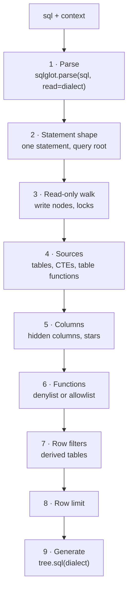

# Design

> Status: **implemented in 0.1.0a1**, except `Policy(schema=...)` for exact column checks (step 5) and the CLI (v0.2). This document is the contract the implementation and its tests follow; changes to it go through a pull request and, if they change behavior, a note in the changelog.

## Goals

1. Decide whether a SQL string written by an untrusted source (an LLM, an agent, a user) is a **single read-only query over allowed objects**.
2. **Rewrite** it so it can only see the rows the current user may see, and only up to a row limit.
3. Do it **deterministically, offline and fast**: no network, no LLM, one dependency ([sqlglot](https://github.com/tobymao/sqlglot)).
4. **Fail closed**: anything that can't be understood is rejected with a reason.

## Non-goals

- Replacing database permissions. A read-only database user is still required (see [THREAT_MODEL.md](THREAT_MODEL.md)).
- Judging whether the SQL answers the user's question correctly.
- Estimating query cost. Use the database's statement timeout; cost heuristics may come later.
- Detecting prompt injection in natural language. sqlguardllm makes a successful injection harmless for data access; it doesn't try to spot it.

## Public API (v0.1)

```python
from sqlguardllm import Guard, Policy, GuardViolation

policy = Policy(
    dialect="postgres",                       # any sqlglot dialect name
    tables={"invoices", "branches", "sales.customers"},
    hidden_columns={"customers.email"},       # "table.column"
    row_filters={"invoices": "branch_id IN ({user.branches})"},
    max_rows=1000,
    default_schema=None,                      # schema assumed for unqualified references
    denied_functions=None,                    # None = built-in list for the dialect
    extra_denied_functions=set(),             # added to the built-in list
    function_policy="denylist",               # "denylist" (default) or "allowlist"
    allowed_functions=None,                   # required when function_policy="allowlist"
)

guard = Guard(policy)                         # validates the policy once (fails fast)

result = guard.check(sql, context={"user": {"branches": [1, 2]}})
result.ok                # bool
result.sql               # rewritten SQL in policy.dialect, or None
result.tables            # frozenset of tables the query reads (after resolution)
result.applied_filters   # list[str], one per injected row filter
result.violations        # list[Violation(code, message, snippet)]

safe_sql = guard.enforce(sql, context=...)    # returns result.sql or raises GuardViolation
safe_execute = guard.wrap(execute, context_fn=lambda: {...})   # decorator-style helper
```

`Policy` is an immutable dataclass. It can also be loaded from YAML or JSON (`Policy.from_file("policy.yaml")`, v0.2).

### Violation codes

Codes are part of the public API and **stable across minor versions**. Messages are human-readable, available in English and Spanish, and may change.

| Code | Meaning |
|---|---|
| `parse_error` | sqlglot could not parse the SQL in the policy's dialect, or fell back to a raw `Command` |
| `empty_statement` | Nothing to run |
| `multiple_statements` | More than one statement |
| `not_a_query` | The statement is not a `SELECT`-family query (`ATTACH`, `PRAGMA`, `EXEC`, `SET`, `CALL`…) |
| `write_operation` | A write or DDL node appears anywhere in the tree (`Insert`, `Update`, `Delete`, `Merge`, `Into`, `Create`, `Drop`, `Alter`, `TruncateTable`, `Copy`…) |
| `row_lock` | `FOR UPDATE` / `FOR SHARE` and similar locking clauses |
| `table_not_allowed` | A table outside the allowlist, including table-valued functions that read external data |
| `hidden_column` | A hidden column is referenced anywhere (select list, `WHERE`, `JOIN`, `ORDER BY`…) or reachable through `*` |
| `denied_function` | A denied function, or any non-allowlisted function in allowlist mode |
| `missing_context` | A row filter needs a context value that wasn't provided |
| `invalid_context` | A context value has a type that can't be bound safely as a literal |

## Pipeline



Steps 1–6 collect **all** violations rather than stopping at the first, so callers (and LLM repair loops) get the full picture. Steps 7–9 only run when there are none.

### 1. Parse

- `sqlglot.parse(sql, read=policy.dialect)` with errors raised, not warned.
- Any `ParseError` → `parse_error`. Verified with sqlglot 30.35: MySQL `SELECT … INTO OUTFILE` and T-SQL `WAITFOR DELAY` don't parse, so they are rejected here.
- When sqlglot falls back to a raw `exp.Command` (it logs *"contains unsupported syntax. Falling back to parsing as a 'Command'"*, e.g. `LOCK TABLE`, `SET ROLE`, `CALL`), the result is `not_a_query`: we never pass through text we didn't parse.

### 2. Statement shape

- Exactly one non-empty statement, else `empty_statement` / `multiple_statements`.
- The root must be `exp.Select` or a set operation (`exp.Union`, `exp.Intersect`, `exp.Except`), possibly wrapped in parentheses. CTEs are an attribute of these nodes in sqlglot, so `WITH … SELECT` passes this step and is inspected in step 3.

### 3. Read-only walk

Walk **every** node (`tree.walk()`), not just the root:

- Write / DDL nodes → `write_operation`: `Insert`, `Update`, `Delete`, `Merge`, `Into`, `Create`, `Drop`, `Alter`, `TruncateTable`, `Copy`, `Grant`, `Revoke`, `Command`, `Execute`, `Attach`, `Detach`, `Pragma`, `Set`, `Use`, `Transaction`, `Commit`, `Rollback`, `Kill`, `LoadData`.
- `Lock` (from `FOR UPDATE` and friends) → `row_lock`.

This is what catches `WITH d AS (DELETE … RETURNING *) SELECT * FROM d` (a `Delete` under a `Select`) and `SELECT * INTO backup FROM invoices` (an `Into` under a `Select`).

### 4. Sources: tables, CTEs and table functions

- Resolve sources per scope with `sqlglot.optimizer.scope`, so a CTE named like a real table refers to the CTE inside its scope and to the table outside it.
- Every physical table must be in `policy.tables` → else `table_not_allowed`.
- **Identifier matching**: unquoted identifiers are normalized with the dialect's rules (`sqlglot.optimizer.normalize_identifiers`); quoted identifiers match exactly. Policy entries may be qualified (`sales.customers`); unqualified references are qualified with `default_schema` when set.
- **Table-valued functions** that read outside the allowlist are sources too, and are rejected unless explicitly allowed: DuckDB `read_csv`, `read_parquet`, `read_json`; PostgreSQL `dblink`; T-SQL `OPENROWSET`, `OPENQUERY`, `OPENDATASOURCE`; and similar.

### 5. Columns

- With table metadata (`Policy(schema={...})`, optional), columns are qualified with `sqlglot.optimizer.qualify` and checked exactly.
- Without metadata, sqlguardllm is conservative: an **unqualified** column whose name matches a hidden column of any source in its scope is a violation. This can reject a legitimate query; it never lets a hidden column through.
- `*` and `t.*` over a source with hidden columns → `hidden_column`. The model has to name the columns it wants.
- References in any clause count, not only the select list: filtering or sorting by a hidden column leaks it too.

### 6. Functions

- **Denylist mode (default)**: built-in per-dialect lists of functions that read files, call the network, sleep, run shell commands or change server state, plus `extra_denied_functions`.
- Names are compared **fully qualified and case-insensitively**. sqlglot represents `DBMS_PIPE.RECEIVE_MESSAGE(…)` as a `Dot` whose right side is an anonymous `RECEIVE_MESSAGE` call (verified with 30.35), so the guard rebuilds `dbms_pipe.receive_message` before comparing.
- Seed lists (to be extended through the [attack gallery](ATTACK_GALLERY.md)):

| Dialect | Denied (non-exhaustive) |
|---|---|
| postgres | `pg_sleep`, `pg_read_file`, `pg_read_binary_file`, `pg_ls_dir`, `pg_stat_file`, `lo_import`, `lo_export`, `lo_unlink`, `dblink`, `dblink_exec`, `pg_terminate_backend`, `pg_cancel_backend`, `set_config`, `nextval`, `setval`, `pg_advisory_lock` |
| mysql | `sleep`, `benchmark`, `load_file`, `get_lock`, `release_lock` |
| tsql | `openrowset`, `openquery`, `opendatasource`, `xp_cmdshell`, `xp_dirtree`, `sp_executesql` |
| oracle | `dbms_pipe.*`, `utl_http.*`, `utl_file.*`, `utl_inaddr.*`, `dbms_lock.sleep`, `dbms_scheduler.*` |
| sqlite | `load_extension`, `readfile`, `writefile` |
| duckdb | `read_csv`, `read_csv_auto`, `read_parquet`, `read_json`, `read_text`, `read_blob`, `glob` |

- **Allowlist mode** (`function_policy="allowlist"`): only functions in `allowed_functions` pass. Recommended when the database has user-defined functions, because any function call can have side effects and a denylist can't know yours.

### 7. Row filters

`row_filters` maps a table to a boolean SQL expression in the policy's dialect, with placeholders:

```python
row_filters={
    "invoices": "branch_id IN ({user.branches})",
    "customers": "tenant_id = {tenant.id} AND deleted_at IS NULL",
}
```

- **Rewrite:** every occurrence of a filtered table, in any scope (joins, subqueries, CTE bodies, set operations), is replaced by `(SELECT * FROM <table> WHERE <filter>) AS <alias>`, keeping the original alias or, without one, the table name. References to a CTE that shadows the table are left alone.
- **Placeholders** are dot paths into `context` (`{user.branches}`). Values are bound with `sqlglot.exp.convert` as literals: `int`, `float`, `Decimal`, `str`, `bool`, `None`, `date`, `datetime`, and lists or tuples of those (rendered as a comma-separated list for `IN`). Other types → `invalid_context`. Strings are escaped by sqlglot, never concatenated.
- **Missing value** → `missing_context`. The query never runs unfiltered.
- Filters are parsed **once, when the `Guard` is created**, with a sentinel in place of each placeholder. A filter that doesn't parse, contains a subquery over a non-allowed table, or puts a placeholder outside a literal position is a policy error raised immediately.

Real output of sqlglot 30.35 for the derived-table rewrite:

```sql
-- Input (postgres)
WITH recent AS (SELECT * FROM invoices WHERE issued_on >= '2026-11-01')
SELECT COUNT(*) FROM recent

-- Output with {"user": {"branches": [1, 2]}}
WITH recent AS (
  SELECT * FROM (
    SELECT * FROM invoices WHERE branch_id IN (1, 2)
  ) AS invoices
  WHERE issued_on >= '2026-11-01'
)
SELECT COUNT(*) FROM recent
```

```sql
-- Input (tsql), max_rows=500
SELECT SUM(total) FROM dbo.invoices WHERE issued_on >= '20261101'

-- Output
SELECT TOP 500 SUM(total)
FROM (SELECT * FROM dbo.invoices WHERE branch_id IN (1, 2)) AS invoices
WHERE issued_on >= '20261101'
```

Why a derived table and not an extra `WHERE` condition: it doesn't need to understand the original predicates, can't be undone by an `OR`, and holds wherever the table appears. Modern optimizers push the predicate down, so the cost is negligible; this will be confirmed with execution plans on real engines.

### 8. Row limit

- No limit on the outermost query → add `max_rows`. A literal limit above `max_rows` → lowered. A non-literal limit (expression or parameter) → replaced by `max_rows`.
- Rendered by sqlglot in the dialect's syntax: `LIMIT n`, `TOP n` (T-SQL), `FETCH FIRST n ROWS ONLY` (Oracle), verified with 30.35.
- Set operations get the limit on the combined result.
- `max_rows=None` disables this step (not recommended).

### 9. Generate

The output is `tree.sql(dialect=policy.dialect)`, optionally pretty-printed. What runs is regenerated from the validated tree, never the input string with patches.

## Performance budget

Target: under **2 ms** median per `check()` for typical analytical queries (one to five joins) on a laptop, measured with `pyperf` in CI from v0.3. Parsing dominates; policy compilation happens once per `Guard`.

## Compatibility

- Python 3.10+.
- sqlglot is the only runtime dependency, pinned to a tested range (`>=30,<31` at first). Every sqlglot minor bump runs the full adversarial corpus before the range is widened.
- Semantic versioning. Before 1.0, minor versions may change the API; violation codes stay stable from v0.1.
