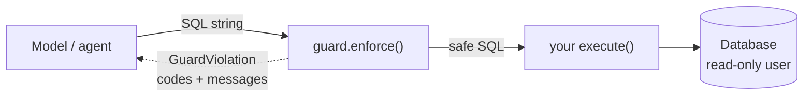

# Integrations

sqlguardllm doesn't depend on any LLM framework. It sits at the one place every text-to-SQL stack has: **the call that executes the SQL the model wrote.**



## The generic pattern

```python
from sqlguardllm import Guard, Policy, GuardViolation

guard = Guard(Policy.from_file("policy.yaml"))

def run_sql(sql: str, user) -> list[tuple]:
    safe_sql = guard.enforce(sql, context={"user": {"id": user.id, "branches": user.branch_ids}})
    with engine.connect() as conn:          # read-only database user
        return conn.exec_driver_sql(safe_sql).fetchall()
```

Return the violation messages to the model when you want it to repair its query: they say what was wrong without exposing anything hidden.

```python
try:
    rows = run_sql(sql, user)
except GuardViolation as e:
    feedback = "; ".join(v.message for v in e.violations)   # e.g. "customers.email is a hidden column"
```

## Recipes

Runnable code for each stack, tested in CI with fake model output, is in **[RECIPES.md](RECIPES.md)** and [`examples/`](../examples). No framework is a dependency of sqlguardllm.

| Stack | Integration point |
|---|---|
| Plain Python (DB-API) / SQLAlchemy | Wrap the function that executes SQL (above): [`generic_wrapper.py`](../examples/generic_wrapper.py), [`sqlalchemy_wrapper.py`](../examples/sqlalchemy_wrapper.py) |
| LangChain | `guard.enforce()` inside the `sql_db_query` tool, or a guarded `SQLDatabase` for langchain-community's toolkit: [`langchain_sql.py`](../examples/langchain_sql.py), [`langchain_community_sql.py`](../examples/langchain_community_sql.py) |
| LlamaIndex | A guarded `SQLDatabase.run_sql()` under its query engines: [`llamaindex_sql.py`](../examples/llamaindex_sql.py) |
| Vanna | A guarded `SqlRunner` for `RunSqlTool`: [`vanna_runner.py`](../examples/vanna_runner.py) |
| MCP | The built-in server, `sqlguardllm mcp`: [MCP.md](MCP.md) |
| [ChatIApp](https://github.com/jmmana/ChatIApp) | Uses sqlguardllm as its SQL guard; policies come from its semantic model |

Using sqlguardllm somewhere else? Open a PR to add your recipe.
