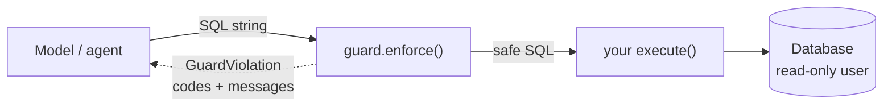

# Integrations

sqlguard doesn't depend on any LLM framework. It sits at the one place every text-to-SQL stack has: **the call that executes the SQL the model wrote.**



## The generic pattern

```python
from sqlguard import Guard, Policy, GuardViolation

guard = Guard(Policy.from_file("policy.yaml"))

def run_sql(sql: str, user) -> list[tuple]:
    safe_sql = guard.enforce(sql, context={"user": {"id": user.id, "branches": user.branch_ids}})
    with engine.connect() as conn:          # read-only database user
        return conn.exec_driver_sql(safe_sql).fetchall()
```

Return the violation messages to the model when you want it to repair its query: they say what was wrong without exposing anything hidden.

```python
try:
    rows = run_sql(sql, user)
except GuardViolation as e:
    feedback = "; ".join(v.message for v in e.violations)   # e.g. "customers.email is a hidden column"
```

## Recipes (planned for v0.3)

Each recipe will live in `examples/` with a test, without adding the framework as a dependency of sqlguard.

| Stack | Integration point |
|---|---|
| Plain Python / SQLAlchemy | Wrap the function that executes SQL (above) |
| LangChain | Wrap the SQL database tool so every query goes through `guard.enforce()` before it runs |
| LlamaIndex | Same idea for its SQL database and query engines |
| Vanna | Validate the generated SQL before Vanna executes it |
| MCP database servers | Call `guard.enforce()` inside the `query` tool, with the context of the authenticated caller |
| [ChatIApp](https://github.com/jmmana/ChatIApp) | Uses sqlguard as its SQL guard; policies come from its semantic model |

Using sqlguard somewhere else? Open a PR to add your recipe.
